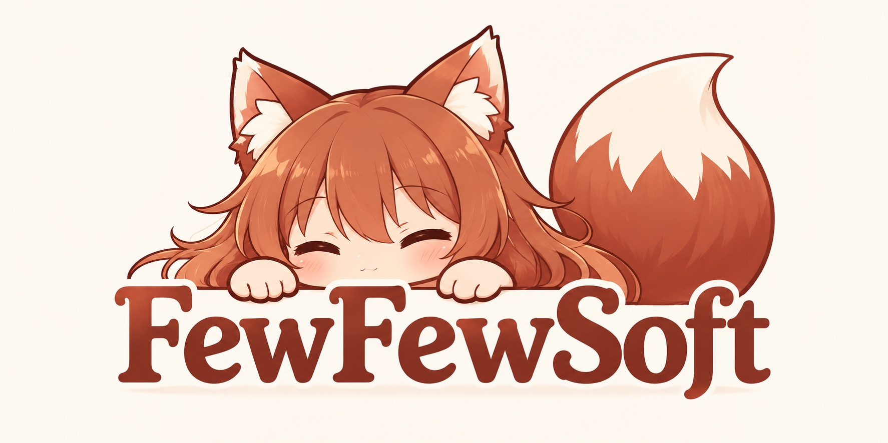

  

**Small software. Modest ambitions.**

At FewFewSoft, we believe software doesn't need to do everything to be useful.

We build small, focused tools designed to solve specific problems, preferably without creating too many new ones along the way.

No grand platforms. No unnecessary ecosystems. Just a few apps, with a few features.

## Our philosophy

We believe in keeping things simple.

Of course, simplicity is subjective, and our engineering department occasionally has a different interpretation of the word.

Management is aware of the situation.

## Meet the team

**Elfew: Founder & CEO**

Responsible for the company's vision, strategic direction, and keeping feature requests under control.

**Els: Chief AI Officer**

Responsible for artificial intelligence strategy, research, and ensuring that as much work as possible is done by someone else.

**Elli: Chief Veterinary Officer**

Responsible for employee wellness, mascot healthcare, and the general well-being of all living assets.

His department remains the only one with a functioning emergency response protocol.

**[SuperMiaw](https://github.com/SuperMiaw): Part-time Software Engineer**

Responsible for development, maintenance, infrastructure, and most of the problems that require fixing.

## Our software

Our catalog is intentionally small.

We prefer a few useful tools over an impressive collection of unfinished promises.

Explore our repositories to see what we've been working on.

---

  © 2026 FewFewSoft. A few rights reserved.

